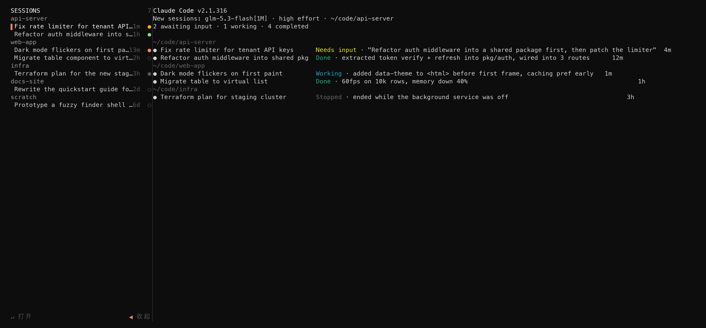
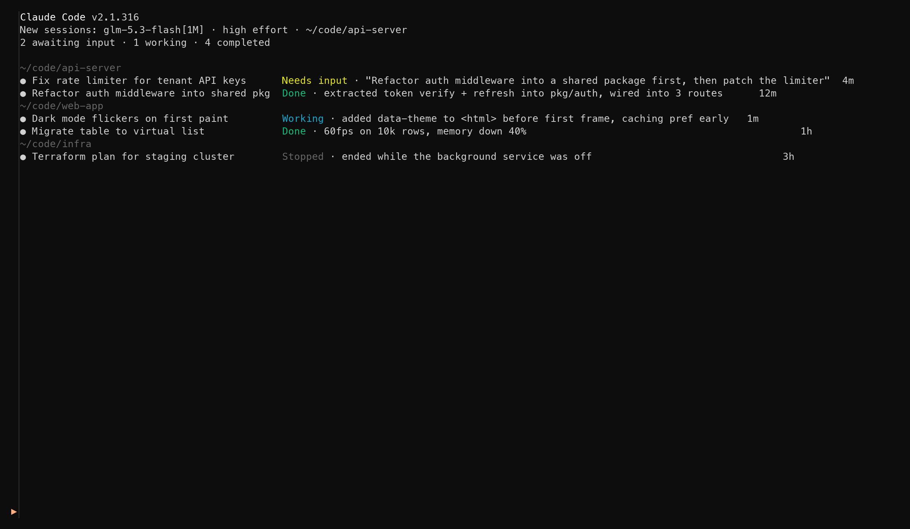

# claude-shannon

  

A tmux workspace that turns [Claude Code](https://docs.anthropic.com/en/docs/claude-code) into a two-pane terminal UI — a session sidebar on the left, Claude Code on the right. No forks, no patches: official Claude Code, wrapped.



*Left: every conversation across all your projects, grouped by workspace, with live status dots. Right: Claude Code — the fleet view by default, or any conversation you click, loaded in place.*

Collapsed state — the sidebar shrinks to a slim rail; one click on `▶` brings it back:



## Why

Claude Code starts in one directory with one conversation, and your history is spread across every project you have ever touched. The built-in fleet view knows about all of it, but you only reach it after launching a session first.

`claude shannon` flips that: the cockpit comes first.

- **One command, the whole picture** — every recent conversation across every project, sorted by activity.
- **Click, don't context-switch** — picking a session loads it into the right pane in place. Your window never changes.
- **Claude stays official** — the right pane runs the unmodified `claude` binary. Upgrades, plugins, settings: all untouched.

## Quickstart

Requirements: **tmux 3.2+**, **python 3.8+** (stdlib only, no pip packages), macOS or Linux.

```sh
# 1. Install tmux
brew install tmux          # macOS
# apt install tmux         # Debian/Ubuntu

# 2. Clone anywhere
git clone git@github.com:BoyceFong/claude-shannon.git ~/.claude-shannon

# 3. Add the launcher to ~/.zshrc (adjust the path if you cloned elsewhere)
claude() {
  if [[ "$1" == "shannon" ]]; then
    command "$HOME/.claude-shannon/bin/claude-shannon"
    return
  fi
  command claude "$@"
}

# 4. Open a new terminal, then from any directory:
claude shannon
```

You should see the two-pane workspace: sessions on the left, Claude Code's fleet view on the right. Click any session — it loads in the right pane.

Every other `claude` usage passes through untouched.

**Contents** — [Why](#why) · [Quickstart](#quickstart) · [Features](#features) · [Configuration](#configuration) · [How it works](#how-it-works) · [Limitations & FAQ](#limitations--faq) · [Contributing](#contributing) · [License](#license)

## Features

- **Cross-project session list** — recent conversations from `~/.claude/projects`, grouped by workspace, newest first.
- **Live status icons, aligned with Claude Code's fleet view** — working: animated spinner (coral); awaiting input: `✱` (yellow); done: `∙` (green); stopped/idle: `∙` (gray); failed: `✱` (red).
- **Hover highlights** — rows, `◀` `▶` `✕` buttons light up under the pointer, like the fleet view.
- **In-place switching** — clicking a row respawns the right pane's Claude host on that conversation. Works across projects, not just the current one.
- **Fleet view as home screen** — the right pane starts on Claude Code's own fleet view; everything you can do there, you can do here.
- **Collapse to a rail** — `M-s` or the `◀ 收起` button shrinks the sidebar to a 2-column rail with a `▶` expand button at the bottom. Nothing is ever destroyed.
- **New session in any project** — `＋ 新建` in the footer lists your known projects; pick one and a brand-new Claude Code session opens in that directory, in the right pane.
- **Quit from the sidebar** — `✕ 退出` in the footer, or `Ctrl+Q`, closes the whole workspace (Claude Code included).
- **Pinned widths, no flicker** — the sidebar is a tmux `main-vertical` main pane: its width is held by tmux itself while you resize the window; only the right pane flexes. Crossing `COLLAPSE_AT` switches between expanded and rail.

## Keybindings

| Key | Action |
| --- | --- |
| `M-s` (Alt+S) | Collapse / expand the sidebar |
| `C-q` (Ctrl+Q) | Quit the workspace |
| `↑` `↓` / `j` `k` | Move the selection (gray highlight band; Enter clears it until the next arrow key) |
| `Enter` | Open the selected session in the right pane |
| Mouse | Click rows and buttons (hover highlights first — no focus click needed); drag the divider to resize |

> macOS `⌘` chords never reach the terminal (the GUI intercepts them), so `⌘X`/`⌘Q` cannot be bound inside tmux — hence Ctrl+Q for quit. If you prefer a Cmd-style quit, map `⌘Q` → "send Ctrl+Q" in your terminal's keyboard settings.
- **Auto-fit** — below `COLLAPSE_AT` columns the sidebar auto-collapses so Claude keeps a usable width; it restores itself when the window grows.
- **Width memory** — drag the divider to whatever width you like; it sticks across collapse/expand cycles.
- **Stable ordering** — loading a conversation never shuffles the list; order is frozen when the workspace opens.

## Configuration

`~/.claude/shannon/config` (created with defaults on first run):

| Key | Default | Meaning |
| --- | --- | --- |
| `SIDEBAR_W` | `35` | Fallback expanded sidebar width (columns) |
| `COLLAPSE_AT` | `70` | Window width below which the sidebar auto-collapses to the rail |
| `RAIL_W` | `2` | Collapsed rail width |

The expanded width you set by dragging the divider is remembered in `~/.claude/shannon/sidebar-w` (clamped to 12–40 columns) and survives restarts.

## How it works

```
╭ sidebar ──╮ ╭ host pane ═══════════════════════════╮
│ python3   │ │ sh/while loop, never exits          │
│ curses    │ │   └─ official `claude`              │
│ reads     │ │       fleet view  →  --resume <id>  │
│ ~/.claude │ │                                     │
╰═══════════╯ ╰═══════════════════════════════════════╯
      tmux session "shannon" (M-s toggles the rail)
```

- **Left pane** — a pure-stdlib curses app. It reads conversation metadata from `~/.claude/projects` (exactly where Claude Code stores transcripts) and live status from `claude agents --json`. Everything stays on your machine.
- **Right pane** — a ~30-line shell host that keeps the pane alive and runs the stock `claude` binary inside it. Switching sessions is a `tmux respawn-pane` with `SHANNON_RESUME=<id>`; no Claude Code internals are touched.
- **State** — `~/.claude/shannon/` holds pane ids, your remembered width, the collapse mode, and `host.log` (why Claude last exited).

## Limitations & FAQ

- **Is this a fork?** No. The right pane runs whatever `claude` is on your `PATH`. If Claude Code changes tomorrow, shannon keeps working.
- **Does switching kill a running turn?** Yes — respawning the host interrupts the current turn. Conversations are persisted after every turn, so the loss is at most a few seconds of generation. The sidebar shows the working dot so you can wait instead.
- **Linux?** Should work — nothing is macOS-specific. Report an issue if something breaks.
- **Nested tmux?** Works, but the rail keybinding (`M-s`) may be captured by the outer session; run the toggle script directly or rebind.
- **Why "shannon"?** The workspace was born in a project folder of that name. It also fits: Shannon gave us the measure of information — this is a pane that shows all of it.

## Contributing

Issues and PRs welcome. The whole app is six small scripts under `bin/` — `claude-shannon` (launcher), `shannon-workspace` (layout), `shannon-host` (right-pane host), `shannon-sidebar` (the curses UI, ~400 lines), `shannon-toggle` / `shannon-autofit` (collapse + resize hooks). Please keep the zero-dependency property: python stdlib and POSIX shell only.

Bug reports and feature requests go to [GitHub Issues](https://github.com/BoyceFong/claude-shannon/issues).

## Support

Questions and usage help: [GitHub Issues](https://github.com/BoyceFong/claude-shannon/issues) — mark non-bug questions with the `question` label.

## Security

All data read by this tool (conversation transcripts, live status) stays on your machine; nothing is sent anywhere. If you believe you found a vulnerability, open a GitHub issue marked **security** rather than emailing.

## License

[MIT](LICENSE)
